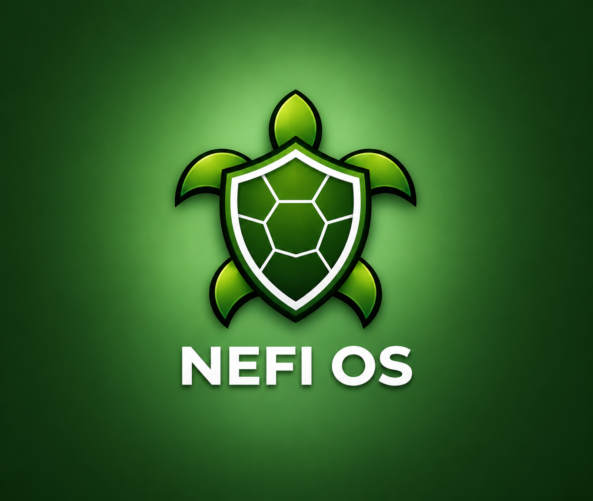

# NEFI OS


**Network Event Forensics Intelligence.** A Debian 13 "trixie" Linux distribution for defensive security (Blue Team): hardening, monitoring, DFIR, incident response and threat hunting from a single interface, the NEFI Security Center.


[](https://github.com/nefios/NEFI-OS/releases)
[](LICENSE)
[](#project-status)
[](https://www.debian.org/)





## Table of contents


- [Overview](#overview)
- [Project status](#project-status)
- [What's new in 0.3](#whats-new-in-03)
- [Features](#features)
- [How it works](#how-it-works)
- [Security by default](#security-by-default)
- [Security Score](#security-score)
- [Tools NEFI is built on](#tools-nefi-is-built-on)
- [Download and verification](#download-and-verification)
- [Installation](#installation)
- [System requirements](#system-requirements)
- [Build from source](#build-from-source)
- [Repository layout](#repository-layout)
- [Documentation](#documentation)
- [Known limitations](#known-limitations-to-fix)
- [Contributing](#contributing)
- [Security policy](#security-policy)
- [License](#license)
- [Disclaimer](#disclaimer)


## Overview


NEFI OS is plain Debian 13 with KDE Plasma 6, a hardened baseline and the NEFI Security Center, a desktop application that measures, prevents, detects and responds to threats. It is aimed at system administrators, small security teams and analysts who want a defensive workstation without assembling and maintaining the toolchain themselves.


Design principles:


- **Defensive scope only.** NEFI OS ships no exploitation frameworks or offensive toolkits. Dual-use utilities such as nmap and tcpdump are included for network analysis and auditing.
- **Established tools, not reinvented ones.** NEFI installs, configures and verifies standard open-source tools (nftables, AppArmor, auditd, Falco, CrowdSec, AIDE, Lynis and others) and presents them in one interface.
- **Evidence over intent.** A check passes only if its effect is verified. A running firewall service with no rules loaded is not counted as protection.
- **Privileged actions need authorization.** The Security Center itself runs as the logged-in user. Actions that change the system require an administrator password.
- **Offline-capable.** The AI assistant runs locally and needs no external service.


## Project status


**Pre-release (0.3).** Tested in virtual machines ([list the hypervisors and versions tested]). Not yet recommended for production use or for systems holding critical data. Behavior on physical hardware has not been validated.


## What's new in 0.3


- **Evidence-based Security Score.** 61 verified checks across 9 areas, with evidence, method, weights and coverage ([methodology](docs/security-score.md)).
- **Nine new System pages.** Hardware, boot chain, kernel, integrity, security services, packages, configuration, backup and updates.
- **Runtime detection and automatic blocking.** Falco and CrowdSec, installed with one click from the Security Center, with desktop notifications.
- **Anti privilege-escalation hardening.** Lynis hardening index raised from 70 to 85.
- **Full-disk encryption proposed by default** in the installer.


Full details: [CHANGELOG](CHANGELOG.md) | [Release notes](docs/release-notes-0.3.md)


## Features


### NEFI Security Center


A PyQt6 application organized in six sections.


| Section | Pages |
|---|---|
| **System** | Security Score, System Overview, Hardware Security, Boot Integrity (Secure Boot, TPM), Kernel Security, System Integrity, Security Services, Package Security, Configuration Audit, Backup and Recovery, Update Health, Snapshots (Btrfs + Snapper) |
| **Prevention** | Hardening Profiles (Home / Professional / Paranoid), Hardening Check, Zero Trust, USB Guardian, Privacy Control, Sandbox (Firejail) |
| **Detection** | EDR, Threat Intelligence and IOC Manager (VirusTotal), Vulnerability Scanner (Lynis), Honeypot, Runtime Alerts (Falco) |
| **DFIR** | Evidence Collection, Integrity Control (AIDE), Log Viewer |
| **Monitoring** | Network Monitor, Process Monitor |
| **Response** | Incident Response mode, Threat Blocking (CrowdSec), NEFI Guardian (local AI assistant, Ollama + Mistral, works offline) |


### Desktop and installer


- KDE Plasma 6 with the NEFI theme.
- Graphical installer (Debian Installer) with NEFI branding and a Software selection screen.
- Desktop notifications for high-priority Falco events and new automatic CrowdSec blocks.


### Installer tasks


| Task | Installs |
|---|---|
| KDE Plasma (NEFI OS desktop) | NEFI desktop theme, Plasma, SDDM, Konsole, Dolphin, Kate, Firefox ESR |
| core | NEFI Security Center and the hardening and security base |
| default | Suricata, YARA, ClamAV, chkrootkit, rkhunter, Lynis, nmap, tcpdump |
| large | default plus DFIR tools: Sleuth Kit, Autopsy, foremost, binwalk, Wireshark and others |
| ai | NEFI Guardian engine (Ollama, about 2 GB; the model is downloaded later) |
| SSH server | openssh-server (opens port 22 in the firewall) |


## How it works


The Security Center runs as the logged-in user. Everything that needs root is a small helper behind `pkexec`, and results come back as JSON reports.


```text
+--------------------------------------------------------------+
|  User session (logged-in user)                               |
|  NEFI Security Center (PyQt6)      nefi-notifier             |
+------------------------------+-------------------------------+
                               | a button that changes the system
                               v
+--------------------------------------------------------------+
|  pkexec + polkit: administrator password for each action     |
+------------------------------+-------------------------------+
                               v
+--------------------------------------------------------------+
|  Root helpers in /opt/nefi (one job each)                    |
|  collect.py (security checks)   other area helpers           |
|  The assessment also runs every 30 minutes (nefi-assess)     |
+------------------------------+-------------------------------+
                               | write JSON reports
                               v
          /var/lib/nefi, /var/log/falco  (root:sudo 0640)
                               ^
                               | read without a password
                    Security Center and notifier
+--------------------------------------------------------------+
|  Security tools: nftables, AppArmor, auditd, AIDE, Falco,    |
|  CrowdSec, Suricata, ClamAV, Lynis, Snapper, Ollama          |
+--------------------------------------------------------------+
|  Debian 13 trixie + KDE Plasma 6 + NEFI hardening baseline   |
+--------------------------------------------------------------+
```


- **Status pages** read the reports directly. Users in the `sudo` group can read them; other users and intruders without `sudo` cannot.
- **Action buttons** start a root helper through `pkexec`. The helper does one job, writes its result and exits.
- **The assessment** also runs on its own, 3 minutes after boot and every 30 minutes, as a sandboxed systemd service.


### Privilege model


- The Security Center is never run as root.
- Root actions are scripts installed by the NEFI packages under `/opt/nefi/`, owned by root, so they cannot be modified by an unprivileged user.
- Root helpers validate the arguments they receive and run external commands with a fixed `PATH`.
- Each feature that touches the firewall uses its own nftables table, and nothing flushes the base table.
- Configuration changes are validated before use where a validator exists (for example `visudo -c` for sudoers and `sshd -t` for SSH).
- Falco and CrowdSec are installed from their official repositories with signing keys. Ollama is bundled in the `nefi-ollama` package from the official upstream release.
- Automatic blocking by CrowdSec is reported in the interface and can be undone by the user.


## Security by default


Defaults applied on a fresh installation, before the first login:


| Area | Default |
|---|---|
| Firewall | nftables, `input` and `forward` policy drop. Allowed in: established and related traffic, loopback, limited ICMP and ICMPv6, DHCP replies. Exceptions are files in `/etc/nefi/firewall.d/` |
| Root account | No root password. The first user is the administrator (`sudo`). `su` restricted to the `sudo` group |
| `sudo` | `use_pty`, logging to `/var/log/sudo.log`, password required again after 5 minutes, 3 tries, strict umask |
| Access control | AppArmor enabled. Unprivileged user namespaces restricted through AppArmor where supported |
| Kernel | kexec off, perf, BPF, userfaultfd and io_uring restricted, BPF JIT hardening, SysRq off, no core dumps, strict network settings |
| Kernel modules | Blocked: dccp, sctp, rds, tipc, FireWire, thunderbolt-net, legacy iptables modules |
| SUID | Removed from chfn, chsh, gpasswd, newgrp, ssh-keysign, pppd, Xorg.wrap and ntfs-3g, preserved across upgrades |
| Compilers | `gcc`, `cc`, `as` and related tools are executable only by root and the `sudo` group |
| SSH (if installed) | No root login, 3 authentication tries, no X11, TCP or agent forwarding, idle timeout, verbose logging |
| Brute force | fail2ban with nftables actions: 3 failures in 10 minutes cause a 1 hour ban, increasing |
| Auditing | auditd rules for critical files, privileged execution, network configuration, firewall and module loading |
| Integrity | AIDE baseline created at first boot, weekly debsums, needrestart |
| Passwords | pam_pwquality (12 characters, 3 classes), password expiry, `UMASK 027` |
| Exposed services | Avahi (mDNS) and KDE Connect disabled, exim4 local only |
| Updates | Automatic security updates |
| Storage | Full-disk encryption (LUKS + LVM) proposed by the installer |


Lynis hardening index: **85** (70 before the 0.3 hardening work). Lynis tests that do not fit a Blue Team workstation are skipped with a documented reason in `/etc/lynis/custom.prf`.


To verify the anti-privilege-escalation settings on a running system:


```bash
sudo /opt/nefi/hardening/verify-antiroot.sh
```


A good installation reports 32 PASS lines.


### Hardening profiles


The **Hardening Profiles** page applies one of three additional levels on top of the baseline: Home, Professional or Paranoid. The Paranoid profile also disables unprivileged user namespaces, which stops Chromium and Electron applications and Flatpak from running.


## Security Score


The Security Score is computed by a single root program, never by the GUI, and a check passes only if its effect is verified.


- **Status of each check:** pass, warn (counts half), fail, or unknown (not verifiable on this machine, for example a VM without a TPM). Unknown is never counted as passed.
- **Evidence and method** are shown when a check is expanded.
- **Coverage** tells you how much of the score is backed by evidence on this machine. A VM typically has lower hardware coverage.


```text
Score    = (sum of weights passed + 1/2 sum of weights warned) / sum of weights verifiable x 100
Coverage = sum of weights verifiable / sum of all weights x 100
```


Full list of checks, weights and rationale: [docs/security-score.md](docs/security-score.md).


## Tools NEFI is built on


| Tool | Role |
|---|---|
| nftables | Firewall: base table plus separate tables for Incident Response and Zero Trust |
| AppArmor | Mandatory access control, user namespace restriction |
| auditd | Kernel audit log |
| fail2ban | Bans addresses after failed logins |
| AIDE, debsums | File-integrity baseline and package checksum verification |
| debsecan | Known CVEs of installed packages (Debian Security Tracker) |
| unattended-upgrades, needrestart | Automatic security updates, services running outdated libraries |
| Lynis | Hardening audit |
| Falco (CNCF) | Runtime threat detection with the modern eBPF driver, installed with one click |
| CrowdSec and nftables bouncer | Detects attacks in logs and blocks hostile addresses, installed with one click |
| Suricata | Network intrusion detection |
| ClamAV, YARA, rkhunter, chkrootkit | Malware and rootkit scanning |
| Firejail | Application sandboxing |
| Snapper and Btrfs | System snapshots and rollback |
| Ollama | Local language-model engine for NEFI Guardian, bound to `127.0.0.1` |
| Sleuth Kit, Autopsy, foremost, binwalk, dc3dd, Wireshark | Optional DFIR toolset |


## Download and verification


Get the ISO from the [Releases page](https://github.com/nefios/NEFI-OS/releases). GitHub limits files to 2 GB, so the ISO is split into parts. Download all `.part` files and join them.


**Linux / macOS**


```bash
cat nefi-os-0.3-amd64.iso.part* > nefi-os-0.3-amd64.iso
```


**Windows** (Command Prompt, in the download folder)


```bat
copy /b nefi-os-0.3-amd64.iso.part* nefi-os-0.3-amd64.iso
```


**Verify the download**


```bash
gpg --import NEFI-OS-RELEASE-KEY.asc
gpg --verify SHA256SUMS.asc SHA256SUMS
sha256sum -c SHA256SUMS --ignore-missing
```


Both checks must report a good signature and `OK`. If either fails, do not use the ISO.


Release key fingerprint: `[XXXX XXXX XXXX XXXX XXXX  XXXX XXXX XXXX XXXX XXXX]`


Compare the fingerprint above with the output of `gpg --verify`, and ideally with a copy published outside this repository. The file `NEFI-OS-RELEASE-KEY-0.2.asc` is the key that signed version 0.2; version 0.3 is signed with `NEFI-OS-RELEASE-KEY.asc`.


## Installation


Write the ISO to a USB stick with balenaEtcher, Rufus (DD mode) or:


```bash
sudo dd if=nefi-os-0.3-amd64.iso of=/dev/sdX bs=4M status=progress conv=fsync
```


Replace `/dev/sdX` with the correct device. `dd` overwrites it without confirmation.


The installer pre-selects sensible defaults and leaves the important decisions to you: the target disk, the encryption passphrase and the user account. It sets the hostname to `nefios` (changeable), enables automatic security updates, configures local-only mail and installs GRUB also in the EFI fallback path.


Recommended partitioning: **Guided - use entire disk and set up encrypted LVM**.


If something looks wrong right after installation, read the setup logs first:


```bash
ls /var/log/nefi-setup/
```


After the first boot, the first security assessment runs after about 3 minutes. You can also open **NEFI Security Center** from the application menu and press **Run checks now**.


Installation on physical hardware is not yet officially supported (see [Project status](#project-status)).


### Trying it in a virtual machine


The safest way to evaluate NEFI OS is in a virtual machine. With QEMU:


```bash
qemu-img create -f qcow2 nefi-os.qcow2 60G
qemu-system-x86_64 -enable-kvm -cpu host -smp 4 -m 8G \
  -drive file=nefi-os.qcow2,format=qcow2 \
  -cdrom nefi-os-0.3-amd64.iso -boot d
```


Other hypervisors (VirtualBox, VMware, virt-manager) can be used too: assign at least 4 GB of RAM and a 30 GB disk. [Add hypervisor-specific notes, such as EFI or graphics settings.]


## System requirements


| | Minimum | Recommended |
|---|---|---|
| CPU | 64-bit (amd64) | 4 or more cores |
| RAM | 4 GB | 8-16 GB to use NEFI Guardian |
| Disk | 30 GB | 60 GB or more, SSD |
| Firmware | BIOS or UEFI | UEFI with Secure Boot |


## Build from source


The ISO is a Debian 13 installer remastered with `simple-cdd` from the official Debian DVD, with NEFI delivered as `.deb` packages.


**Build host:** Debian 13. A VM with 8 GB of RAM and about 100 GB of free disk is sufficient.


1. Install the build dependencies:


```bash
sudo apt install live-build simple-cdd debian-cd reprepro xorriso python3-pil dpkg-dev
```


`simple-cdd` 0.6.10 or later is required for trixie. Version 0.6.9 attempts to fetch i386 installer images.


2. Clone the repository:


```bash
git clone https://github.com/nefios/NEFI-OS.git ~/nefi-os
```


3. The build starts from the official Debian 13 amd64 DVD image (`debian-13-amd64-DVD-1.iso`), which must be present in `installer/images/`. It is not stored in Git.


4. Add Ollama, which is not stored in Git. Download the official Linux amd64 release and place its files as follows:


| Source | Destination |
|---|---|
| `bin/ollama` | `config/includes.chroot/usr/local/bin/ollama` |
| `lib/ollama/` | `config/includes.chroot/usr/local/lib/ollama/` |


5. Run the build from the `installer` directory:


```bash
cd ~/nefi-os/installer
./build.sh
```


The ISO is written to `installer/images/nefi-os-<version>-amd64.iso`. The full log is `~/nefi-installer-build.log`.


> The `build.sh` in the repository root is the obsolete live-build script from version 0.1. Do not use it.


### What the build does


| Step | Action |
|---|---|
| 0 | Generates and builds the NEFI `.deb` packages and the installer task definitions |
| 1 | Downloads firmware metadata so the installer can suggest firmware |
| 2 | Remasters the Debian DVD with `simple-cdd`: NEFI packages, preseed and offline package list |
| 3 | Applies the NEFI graphics to the installer |
| 4 | Verifies that the ISO was produced and reports how full it is |


The build modifies version stamps in `packages/*/DEBIAN/control`. Restore them afterwards and never commit them:


```bash
git checkout -- $(git diff --name-only | grep DEBIAN/control)
```


### Packages


| Package | Contents |
|---|---|
| `nefi-security-center` | The application, all modules, `/opt/nefi/*` helpers, NEFI systemd units, sysctl, audit, SSH and udev files, setup hooks |
| `nefi-desktop` | KDE theme, colors, wallpapers, panels, SDDM, splash, Plymouth, `/etc/skel` |
| `nefi-ollama` | Ollama engine and its sandboxed systemd unit (optional) |
| `nefi-branding` | `/usr/lib/os-release` (name and version of NEFI OS) |
| `nefi-tasks` | The installer's Software selection entries |


Every NEFI file is owned by a package, and the few Debian files that NEFI replaces are moved aside with `dpkg-divert`, so `dpkg -S` and upgrades keep working. Every file under `/etc` is a conffile, so local changes survive upgrades.


## Repository layout


Paths under `config/includes.chroot/` are the final paths on the installed system.


| Path | Content |
|---|---|
| `config/includes.chroot/usr/bin/` | Launchers: `nefi-security-center`, `nefi-notifier` |
| `config/includes.chroot/usr/lib/nefi/modules/` | Security Center Python modules, theme and main window |
| `config/includes.chroot/opt/nefi/<area>/` | Privileged backends, one folder per area |
| `config/includes.chroot/etc/` | systemd units, sysctl, SSH, audit and udev rules, KDE defaults |
| `config/hooks/normal/` | Setup scripts run once at first install (hardening, tool configuration, Ollama, NEFI setup, branding) |
| `packages/` | `.deb` package generators |
| `installer/` | Debian Installer build: `build.sh`, simple-cdd configuration, preseed, offline package list |
| `branding/` | Installer artwork and generators |
| `docs/` | Public documentation |


## Documentation


| Document | Content |
|---|---|
| [Security Score methodology](docs/security-score.md) | Checks, categories, weights and coverage |
| [Release notes 0.3](docs/release-notes-0.3.md) | What changed in this release |
| [CHANGELOG](CHANGELOG.md) | Project history |
| [SECURITY.md](SECURITY.md) | Vulnerability reporting |


## Known limitations to fix


- Validated only in virtual machines. Physical hardware is untested.
- Many hardware checks (TPM, IOMMU, microcode) are reported as "not verifiable" in a VM. This is expected and reflected in the coverage value.
- The Paranoid hardening profile stops Chromium and Electron applications and Flatpak from running.
- [Secure Boot behavior with the custom installer: describe what is supported.]


## Contributing


Bug reports, hardware and hypervisor test results, and documentation feedback are welcome through [GitHub Issues](https://github.com/nefios/NEFI-OS/issues). [State here how code contributions are handled, for example whether pull requests are accepted on this repository.]


## Security policy


To report a vulnerability, follow [SECURITY.md](SECURITY.md) and report it privately. Do not open a public issue.


## License


NEFI OS code is released under the GNU General Public License v3.0 (see [LICENSE](LICENSE)). Debian packages, Ollama and all other third-party components keep their own licenses; their sources are available from the Debian archive and their upstream projects.


## Disclaimer


NEFI OS is provided "as is", without warranty. It is intended to help you defend systems you own or are authorized to protect. No software makes a system perfectly secure.


